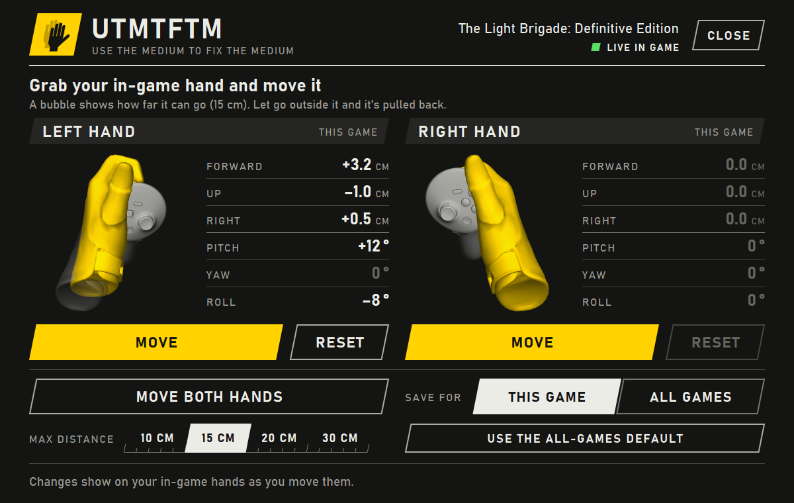
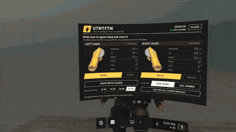
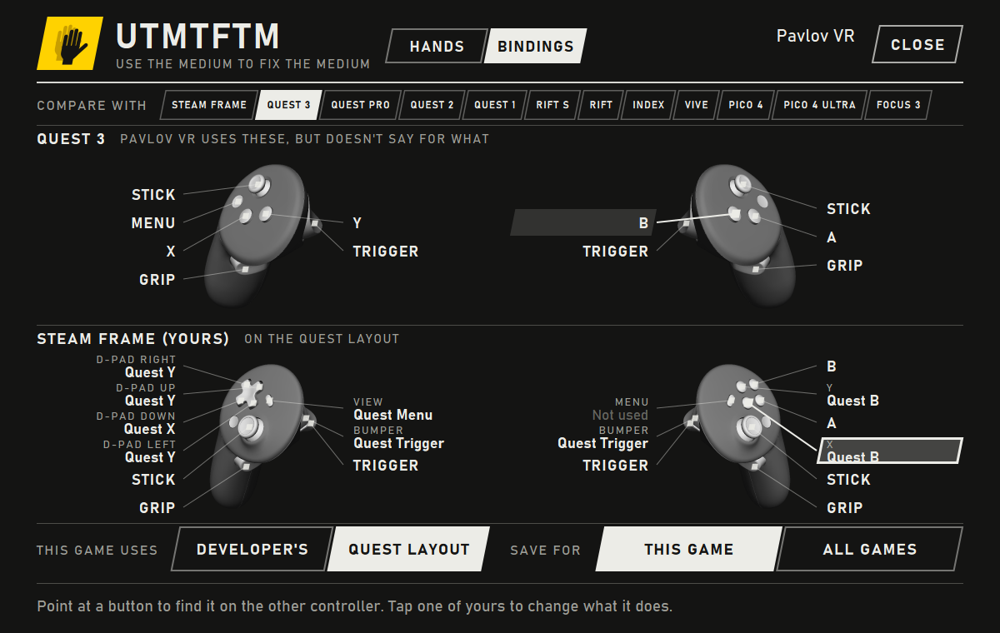
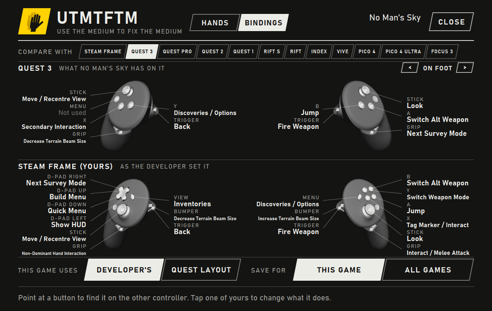
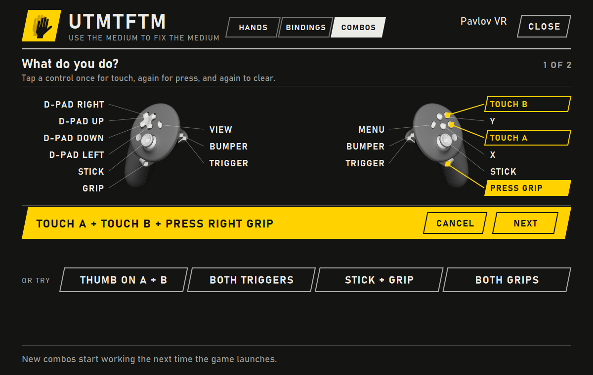

# UTMTFTM

Use The Medium To Fix The Medium. It's an easy offset for your VR hands: open the SteamVR dashboard, click Move, grab the hand with your other hand and put it where it belongs. You see it move in the game while you do it, and it saves for that game or for every game.



My in-game hands don't line up with my real hands, and it's different in each game. SteamVR can offset your controllers, but you go through the binding menus, type in numbers and restart the game to find out if you guessed right. Here you move it by hand and see the result right away.



It runs in the background as a SteamVR add-on, on Windows for PC VR and on the Steam Frame itself for games running on the headset. The page only draws while the dashboard is open or you're placing a hand. There are numbers in [docs/how-it-works.md](docs/how-it-works.md) if you want them.

It's free, and I'm sharing it in case it's useful to someone else.

## Install

### Windows

Use this one if you play PC VR, including when you stream to a Steam Frame.

1. Close SteamVR.
2. Download `UTMTFTM-Setup` from the [latest release](../../releases/latest) and run it. It doesn't need admin rights. It isn't code-signed, so Windows may show a blue warning: click **More info**, then **Run anyway**.
3. Start SteamVR.

There's a zip on the release page too, if you'd rather skip the installer. Unpack it somewhere you'll leave it and double-click `install.cmd`.

### Steam Frame

Use this one for games running on the headset.

1. In Steam, go to **Settings > System** and turn on **Enable Developer Mode**. Konsole doesn't show up without it.
2. Open **Konsole** from the **+** on the bar at the bottom.
3. Paste this and press Enter:

   ```sh
   curl -fsSL https://github.com/RxVreality/UTMTFTM/releases/latest/download/install-frame.sh | sh
   ```

It installs into your home folder and doesn't need sudo. At the end it restarts SteamVR to load the add-on, which closes anything that's running, so don't do this in the middle of a game. Konsole closes too, and when everything comes back the yellow hand is in the dashboard.

## Using it

Start your game first, then:

1. Open the SteamVR dashboard and click the yellow hand. The top right of the page should say **Live in game**.
2. Click **Move** under the hand you want to fix, or **Move both hands**.
3. Close the dashboard.
4. Reach over with your other hand, squeeze grip and drag the hand where it should be. A bubble shows how far it can go, 15 cm unless you change it on the page. Let go outside the bubble and it gets pulled back. Rotation isn't limited.
5. Pull the trigger to lock it in.

A small panel floats next to your hand the whole time and tells you which buttons do what on your controller.

On a Frame you can also get to it from the **+** on the bar at the bottom.

**Save for** on the page picks between this game and all games. **Reset** clears a hand. With no game running you can still set the default for all games, you just won't see it until you start one.

If a hand's nearly right, **Fine adjust** on the page puts arrows next to each number, for when you'd like it 1 degree to the left. They go 1 mm and 1 degree a tap, or 1 cm and 5 degrees. The hand you aren't pointing with moves as you tap, as long as the game still draws it behind the dashboard. This one's new and hasn't had much use yet.

It works with anything that runs through SteamVR, on OpenVR or OpenXR. The add-on moves the controller inside SteamVR, so nothing gets loaded into the game. Pavlov has been fine with that, but I can't speak for every anti-cheat out there.

## Bindings

I never got on with Steam's binding screen, so there's a simpler one here. The **Bindings** tab at the top of the page shows your controllers at the bottom and any other controller you pick at the top, both at once. Every button has a line to its spot on the controller. Point the laser at one and its line lights up, along with its match on the other controller. If the game names its buttons, the match is whichever button does the same thing.



Pick what to compare with from the row of names. With a game running, each button says what it does in that game, either because the game tells SteamVR or because I looked it up. No Man's Sky names everything, so if you pick Quest 3 there, the page shows that the Quest's B is Jump, and that Jump is A on your Frame. Games with a lot of controls split them into sets like On Foot and Flight, and the arrows at the top right move between them.



### Using another controller's layout

If you don't like what the developer picked for your controller:

1. Pick the controller whose layout you'd rather have.
2. Next to **This game uses**, tap its layout, like **Quest layout**. **Developer's** puts it back.
3. Restart the game. A new layout doesn't apply until then.

SteamVR already translates between controllers when a game has nothing for yours, and this starts from the same translation. Here you can see it and choose it, even for games that have their own bindings for your controller.

### Changing one button

Tap the button on your own controller, and a yellow bar asks what it should do. Tap that on the controller above, or **Nothing** to switch it off. If you just want to swap your own buttons around, pick your own controller to compare with. **Undo rewiring** takes it all back.

**Save for** picks between this game and every game. With **All games**, any game that has bindings for the other controller picks up the layout once you've played it and started it again.

### What to expect

- Lots of games don't tell SteamVR what their buttons do, because Unity and Unreal usually pass along only the button's own name. For 47 of them I looked up the controls, from the game's own files where I could and otherwise from developers' guides and reviews, and the top of the page says which. Plenty of games had nothing solid, so those only show how the buttons match up. The full list and sources are in [input/game_labels.json](input/game_labels.json). I've checked Pavlov and Titan Isles in the game on my Frame. The rest come straight from those sources and I haven't confirmed them in a headset.
- Those are the default controls, so a setting, a left-handed mode or a game update can change them. If you spot a wrong one, please tell me.
- You'll see some blanks on purpose. Games can give each controller its own layout, so a button only gets a label if the game's own bindings prove it's the same action.
- It only knows a game's bindings once you've played it on that machine, unless the game ships them with its files.
- Layouts don't switch mid-game. SteamVR's own binding screen can do that, but it uses a locked internal API that I've left alone.
- Rewiring one button does work mid-game, when what you want it to do is already on another button. The add-on just sends that press as the other one until the next launch. The page says whether you got that or have to restart the game.
- A layout is an ordinary SteamVR binding, so it stays in place if you switch the add-on off in Manage Add-ons. Removing the add-on puts everything back.
- I've used the page on my Frame, and what it writes matches SteamVR's own translation, but I haven't played a game on a translated layout yet. If one misbehaves, tap **Developer's**, restart the game and please tell me.

There's more on how it finds all this in [docs/how-it-works.md](docs/how-it-works.md#the-bindings-page).

## Combos

A combo is a macro for your controller: hold two or more controls together and they do one thing in the game. Touching counts and doesn't press anything, so your thumb on A and B can be its own action without setting off A or B. VRChat players build these by hand in Steam's binding screen, and this is the same thing without the binding screen.



1. With a game running, open the **Combos** tab and tap **New combo**.
2. Tap each control you want in it: once for touch, again for press, and again to clear it.
3. Tap **Next** and pick what it should do.
4. If what it sets off is already on a button, it works straight away. Otherwise restart the game.

**Remove** takes one out again. Each game can have six.

**This is the newest part and it hasn't had much testing.** It writes combos the same way Steam's binding screen does, but it hasn't had much time in real games, and I'm least sure about OpenXR games. SteamVR doesn't say whether a combo stops its buttons doing what they normally do, so pressing something that's already in use might do both, and the Combos tab warns you about that. If one misbehaves, tap **Remove**, restart the game and please [open an issue](../../issues/new) with the game's name.

### Recorded combos

Under **Advanced** on the Combos tab. It's the other way round from a combo: one button plays a whole sequence. Say you want B to hold A, pull the trigger, then let go of both.

1. With a game running, open **Combos**, then **Advanced**, then **Record new**.
2. Let go of everything, wait for the countdown, and do what you'd like the button to do. Your presses don't reach the dashboard while it's recording, so you don't have to aim the laser anywhere. It stops by itself 2 seconds after you let go.
3. Check the steps. Tap one to move it or delete it.
4. Tap **Choose a button** and press the one that should play it. That button stops doing its usual job in that game while this is saved.
5. **Save**, and close the dashboard. There's no need to restart the game.

Once by default, or over and over while you hold the button. Steps are 50 ms apart unless you pick **As I did it**. Resting a thumb on something doesn't count as a step unless that's all you did, or you ask for it.

It doesn't run while the dashboard is open or while you're placing a hand.

## Controllers

The picture on the page and the position of the grip come from SteamVR, so it should follow whatever controller you're holding. The buttons need a binding for each kind of controller, and these are the ones it has:

| Controller | Status |
| --- | --- |
| Steam Frame, on the headset | Tested in Pavlov and Forefront |
| Steam Frame, streaming from a PC | Tested in Pavlov, Forefront and The Light Brigade |
| Quest 3 | Tested in Bonelab |
| Quest 1, 2 and Pro, Rift, Rift S | Set up, not tried yet |
| Valve Index | Set up, not tried yet |
| Vive wands | Set up, not tried yet |
| Pico 4, Vive Focus 3 | Set up, not tried yet |
| Windows Mixed Reality, HP Reverb, Vive Cosmos | Set up, not tried yet, and I couldn't check the button names against SteamVR because their drivers aren't on my PC |

If you try one that isn't marked tested, please [tell me how it went](../../issues/new?template=controller_report.yml), even if it just worked.

Anything else, like PSVR2, depends on SteamVR mapping one of these bindings across by itself, and the panel will call the buttons A and B.

## Limitations

- Games that skip SteamVR aren't affected. That means native Oculus PC games, and games running on Virtual Desktop's own OpenXR runtime.
- Hand tracking isn't supported.
- Offsets pause while the dashboard is open and when no game is running, so your laser pointer comes from where the controller really is. On a Frame that includes streaming from a PC, so if you stream, set your offsets on the PC.
- The add-on hooks into a part of SteamVR that Valve doesn't officially offer for this, so a SteamVR update could break it. If that happens, switch it off in Manage Add-ons and SteamVR goes back to normal.

## Problems

**The page says "Applies next launch" instead of "Live in game".** The add-on isn't running. In SteamVR go to **Settings > Startup/Shutdown > Manage Add-ons**, make sure UTMTFTM is on, and restart SteamVR.

**No yellow hand in the dashboard.** Same fix. The program closes itself when the add-on is switched off, on purpose.

**A game's buttons stopped working after picking a layout.** Tap **Developer's** on the Bindings tab and restart the game. If you'd tell me which game and which layout, I'd like to know.

The logs are `utmtftm.log` and `driver.log`, in `%LOCALAPPDATA%\UTMTFTM` on Windows and `~/.local/share/UTMTFTM` on a Frame. Please attach them to bug reports.

## Removing it

**On Windows:** **Settings > Apps > Installed apps > UTMTFTM > Uninstall**, with SteamVR closed. It asks whether to delete your saved offsets too.

**On a Frame:** run this in Konsole. It restarts SteamVR when it's done. Add `--purge` to delete your saved offsets too.

```sh
sh ~/.local/share/UTMTFTM/app/uninstall.sh
```

If you just want it out of the way for a while, switch it off in Manage Add-ons.

## Building

**Windows:** you need Visual Studio 2022 or its Build Tools, with the C++ workload and CMake, and [vcpkg](https://vcpkg.io/).

```bat
vcpkg install --triplet x64-windows-static
build.cmd
```

`packaging\make-release.ps1` makes the installer and zip.

**Steam Frame:** build it on ARM64 Linux, with CMake, Ninja, g++, and the development files for cairo, FreeType and Vulkan. The Frame has all of those itself.

```sh
sh build.sh
```

`packaging/linux/make-release.sh` makes the download, and `tests/test_frame_run.sh` installs that and runs it against a simulated SteamVR.

Both build into `dist` and run the tests, none of which need a headset or SteamVR.

To add a controller, add a file to `input/` and list it in `input/actions.json`. `test_controllers` checks it against SteamVR's description of that controller.

## Credits

Built with [Claude Code](https://claude.com/claude-code). I came up with the idea, tested it in the headset and told it what was wrong.

Recorded combos came from [u/MMeNDtal](https://www.reddit.com/user/MMeNDtal/) on Reddit, who explained what they should do, using a Logitech mouse's macros as the example, and also found the bug where tapping on the page didn't show until the laser moved.

## License

MIT, see [LICENSE](LICENSE). The libraries it uses are listed in [THIRD_PARTY_NOTICES.md](THIRD_PARTY_NOTICES.md).

Not made by or connected with Valve. The hand and controller models you see are read from your own SteamVR install while it runs, and aren't included here.
