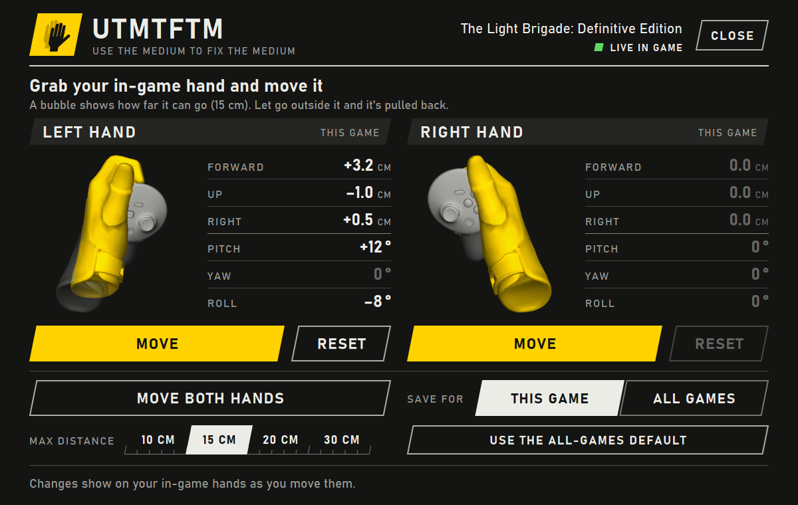
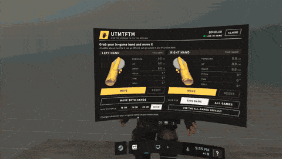
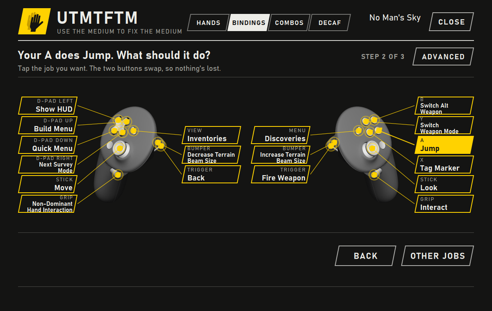
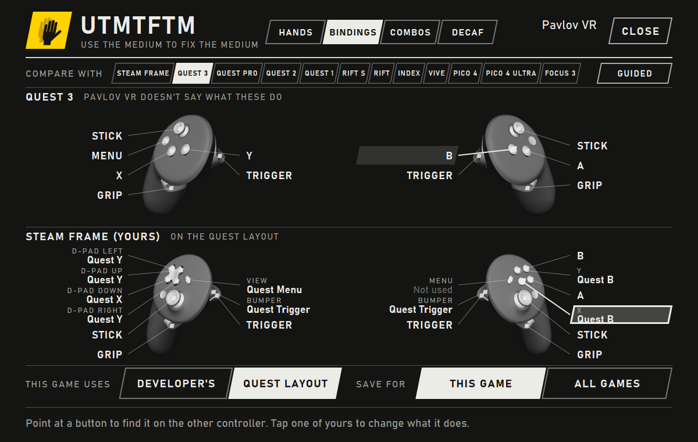
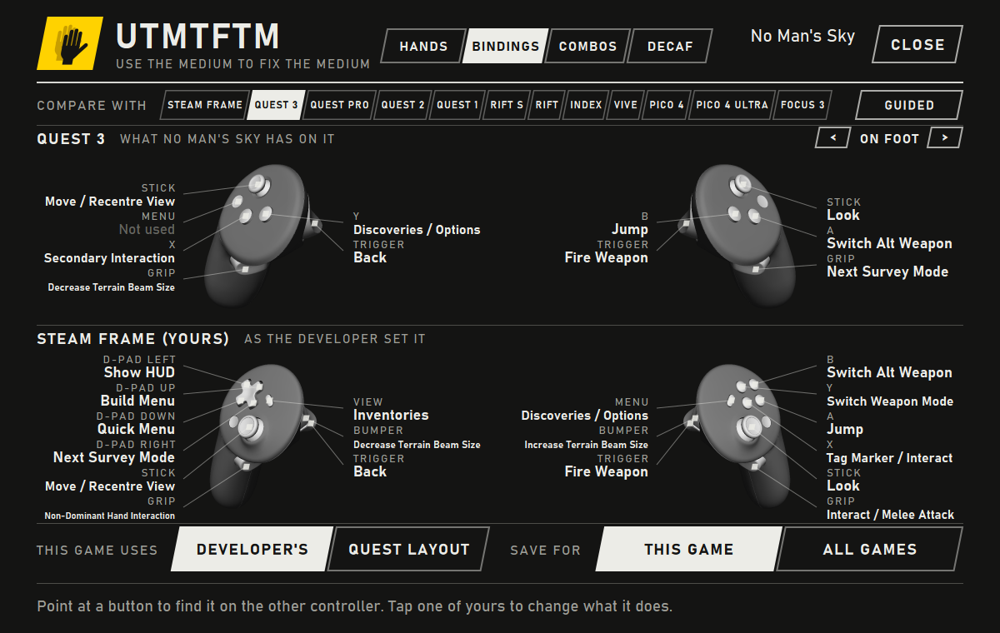
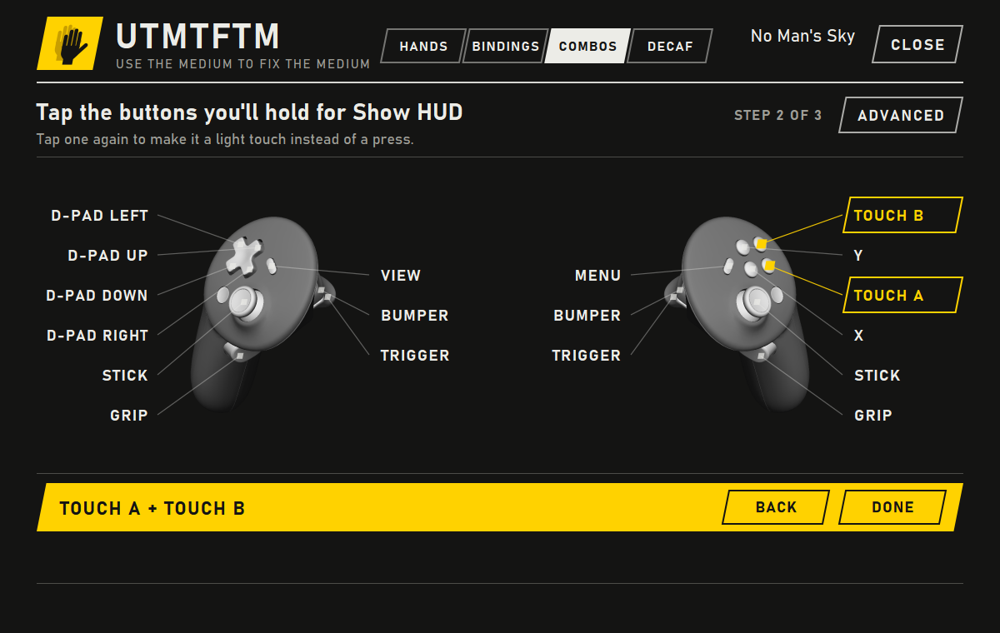

# UTMTFTM

Use The Medium To Fix The Medium. It's an easy offset for your VR hands: open the SteamVR dashboard, click Move, grab the hand with your other hand and put it where it belongs. You see it move in the game while you do it, and it saves for that game or for every game.



My in-game hands don't line up with my real hands, and it's different in each game. SteamVR can offset your controllers, but you go through the binding menus, type in numbers and restart the game to find out if you guessed right. Here you move it by hand and see the result right away.



It runs in the background as a SteamVR add-on, on Windows for PC VR and on the Steam Frame itself for games running on the headset. The page only draws while the dashboard is open or you're placing a hand. There are numbers in [docs/how-it-works.md](docs/how-it-works.md) if you want them.

It's free, and I'm sharing it in case it's useful to someone else.

## Install

### Windows (beta)

Use this one if you play PC VR, including when you stream to a Steam Frame.

It's purple, and the Frame version is yellow, so if you have both you can tell which one you're looking at. While a Frame streams from your PC, its own copy doesn't move your hands, so place them with the purple one.

The Windows version is a beta. UTMTFTM started on the Frame, where it runs natively on the headset, and that's where I've used it most. On a PC there's more in between: streaming apps like Virtual Desktop, Quest Link and Steam Link, lots of different headsets and controllers, and Windows deciding which program runs when. 0.6.1 fixed a lag that only showed up there, in heavy games like Pavlov. It may have bugs the Frame version doesn't, so if something feels off, please [open an issue](../../issues/new) and attach your logs.

1. Close SteamVR.
2. Download `UTMTFTM-Setup` from the [latest release](../../releases/latest) and run it. It doesn't need admin rights. It isn't code-signed, so Windows may show a blue warning: click **More info**, then **Run anyway**.
3. Start SteamVR.

There's a zip on the release page too, if you'd rather skip the installer. Unpack it somewhere you'll leave it and double-click `install.cmd`.

### Steam Frame

Use this one for games running on the headset. There are two ways to put it there.

**With FrameDrop.** If you already send things to your Frame with [FrameDrop](https://framedropvr.com) on a Windows PC:

1. Click **[Install with FrameDrop](https://framedropvr.com/install/?manifest=https%3A%2F%2Fgithub.com%2FRxVreality%2FUTMTFTM%2Freleases%2Flatest%2Fdownload%2Futmtftm.framedrop.json)** and say yes when FrameDrop asks.
2. On the headset, find **UTMTFTM** in your Steam library and press **Play**. Nothing shows for a few seconds, then SteamVR restarts to load the add-on. That closes anything that's running, so don't do it mid-game.

After that, **Play** on UTMTFTM just opens the yellow hand's page. For a new version, click the button again and press **Play** once more.

**With Konsole:**

1. In Steam, go to **Settings > System** and turn on **Enable Developer Mode**. Konsole doesn't show up without it.
2. Open **Konsole** from the **+** on the bar at the bottom.
3. Paste this and press Enter:

   ```sh
   curl -fsSL https://github.com/RxVreality/UTMTFTM/releases/latest/download/install-frame.sh | sh
   ```

It installs into your home folder and doesn't need sudo. At the end it restarts SteamVR to load the add-on, which closes anything that's running, so don't do this in the middle of a game. Konsole closes too, and when everything comes back the yellow hand is in the dashboard.

### Updates

UTMTFTM checks for a newer version by itself. When there is one, the line along the bottom of the page says so, with an **Update** button.

On Windows, the Update page hands the download to your web browser, and you open the installer yourself, the same as the first time. SteamVR can stay open while you do: the new version goes in next to the one SteamVR is using and starts the next time you start SteamVR. UTMTFTM itself never downloads or runs an installer. 0.6.1 did both out of sight, which is exactly what a Trojan does, and an antivirus said so.

On the Steam Frame, the button downloads the new version, checks it's exactly the file on the release page, and installs it while you play. Restart SteamVR or the headset to start using it.

Either way your offsets, layouts, combos and macros stay as they are.

If a SteamVR update ever breaks something and a fixed version is out, the line turns red and says this version may not work properly any more.

To check, it asks GitHub which release is newest when it starts and every six hours after that, the same way a browser would open the releases page. On Windows it asks through Windows' own web library, without starting any other program. There's no account and nothing else goes with it. To turn it off, set the environment variable `UTMTFTM_NO_UPDATE_CHECK=1`.

You'll need to install 0.6.1 itself by hand, the way you did the first time. On Windows, get 0.6.2 by hand too: 0.6.1's own Update button still does it the old way, out of sight.

## Using it

Start your game first, then:

1. Open the SteamVR dashboard and click the yellow hand (purple on Windows). The top right of the page should say **Live in game**.
2. Click **Move** under the hand you want to fix, or **Move both hands**.
3. Close the dashboard.
4. Reach over with your other hand, squeeze grip and drag the hand where it should be. A bubble shows how far it can go, 15 cm unless you change it on the page. Let go outside the bubble and it gets pulled back. Rotation isn't limited.
5. Pull the trigger to lock it in.

A small panel floats next to your hand the whole time and tells you which buttons do what on your controller.

On a Frame you can also get to it from the **+** on the bar at the bottom.

**Save for** on the page picks between this game and all games. **Reset** clears a hand. With no game running you can still set the default for all games, you just won't see it until you start one.

If a hand's nearly right, **Fine adjust** on the page puts arrows next to each number, for when you'd like it 1 degree to the left. They go 1 mm and 1 degree a tap, or 1 cm and 5 degrees. The hand you aren't pointing with moves as you tap, as long as the game still draws it behind the dashboard. This one's new and hasn't had much use yet.

It works with anything that runs through SteamVR, on OpenVR or OpenXR. The add-on moves the controller inside SteamVR, so nothing gets loaded into the game. Pavlov has been fine with that, but I can't speak for every anti-cheat out there.

## Decaf

Decaffeinate takes the little shakes out of your hands while you hold them still, which is mostly what you notice aiming at something far away. It should let go the moment you move, so turning and flicking to a new target feel the same as before.

It's on the **Decaf** tab. Pick **Off**, **Tuned**, **Strong** or **Maximum**, and save it for this game or all games, the same way as on the Hands tab. **Use the all-games step** puts a game back on the shared one. It's off until you turn it on, and changes take effect straight away.

**Strength**, under the steps, makes the one you picked lighter or heavier, from 25% to 150%. 100% is the step as I tuned it. Tap the bar or drag it, and your hands change as you drag. It's saved the same way as the step. If even Tuned feels like it pushes back on small aiming corrections, try 50%: in the tests, slow moves trail half as far behind there, and most of the shake still goes.

While the dashboard is open, the hand you point with isn't smoothed, so the laser stays where you aim it. Its side of the page says so. The other hand stays smoothed so you can see it working. Smoothing happens before your hand offset goes on, so your offsets don't change.

Some games give your hands weight of their own, so your in-game hands or weapons trail behind your real ones on purpose, and some smooth or steady your aim themselves. Decaf adds to that. There's a list of these games in `input/hand_weights.json`, from developer notes, reviews and players, and when you're in one, the bottom of the Decaf page says so. Where the sources are solid, a game that weights your hands starts at 50% strength until you set your own. Where only players say it might, the note says "may" and nothing changes by itself. If a game is missing or wrong, please open an issue.

The figures on each step, like how much less shake, come from a simulated trembling hand in the tests, not from a headset. I've only had a quick try of Maximum in Pavlov Shack and Titan Isles on my Frame. It felt good, but I haven't tried the other steps in a game, so I'd really like to hear how it feels for you.

### Stick drift

A worn stick doesn't come back to the middle when you let go, so your character creeps or your view slowly turns. Quest controllers are known for it. Tap **Sticks** at the top right of the Decaf tab, then **Check my sticks**. It takes about half a minute:

1. Let go of both sticks and keep still for a few seconds.
2. Roll each stick slowly round its edge.
3. Flick each stick up, right, down and left, letting it spring back, twice each way.

From that it works out where each stick really rests, how far off it lands each time you let go, and how far it still reaches each way. After that the game sees the middle whenever you let go, and a full push still goes all the way, even on a side that's worn short. While your thumb is off the stick it keeps learning where the stick rests, since anything a stick says with nobody touching it is drift. The odd one-off spike from a worn stick is ignored.

It's saved per controller, so a different controller gets its own check. It works in every game and in SteamVR's own menus, and nothing changes until you run the check. **Fix drift** turns it off and on. A stick that rests and lands in the middle is left alone, even if your roll round the edge didn't go all the way out somewhere. That means one kind of drift isn't properly caught yet: a stick that rests in the middle but, at certain spots as you circle it, flicks very fast to another point and back. It looks like jitter, and it's why some directions never read 100%. 0.6.3 can call a stick like that fine. I'm working on a better fix for 0.6.4. It's only in the Windows version for now: the Steam Frame's sticks use magnets and don't wear this way, so the Frame version doesn't have it.

I've run the check on my own Quest 3 over Virtual Desktop and on made-up worn sticks in the tests. My Quest 3 sticks do drift, but in the flicking way above, which this version doesn't fully catch. I haven't tried it on a stick that rests off the middle yet. If you have one, or one that flicks like mine, I'd love to hear how it does.

## Bindings

I never got on with Steam's binding screen, so there's a simpler one here. With a game running, the **Bindings** tab opens on your own controllers with every button flashing, and asks which one you want to change. Point at it on the picture and tap, then tap the job you'd like it to have on another button. The two buttons swap, and it works in the game straight away.



**Other jobs** lists what the game has that isn't on any button, and **Nothing** switches a button off. Those two go in the game's binding, so they take effect the next time the game starts, and the page says so. **Undo** takes back the last change. **Put it all back**, on the first screen, takes back everything you changed for that game.

Lots of games tie a job to a hand. Titan Isles only jumps from the right hand's A, and a binding file can't move that to the left hand, so swaps here are done by the add-on instead: it sends one button's presses as the other's whenever that game runs. Changes made here are saved for the game you're in and nowhere else.

### Advanced

**Advanced**, at the top right of the walkthrough, opens the full page from before, and **Guided** brings you back. It shows your controllers at the bottom and any other controller you pick at the top, both at once. Every button has a line to its spot on the controller. Point the laser at one and its line lights up, along with its match on the other controller. If the game names its buttons, the match is whichever button does the same thing.



Pick what to compare with from the row of names. With a game running, each button says what it does in that game, either because the game tells SteamVR or because I looked it up. No Man's Sky names everything, so if you pick Quest 3 there, the page shows that the Quest's B is Jump, and that Jump is A on your Frame. Games with a lot of controls split them into sets like On Foot and Flight, and the arrows at the top right move between them.



### Using another controller's layout

If you don't like what the developer picked for your controller:

1. Pick the controller whose layout you'd rather have.
2. Next to **This game uses**, tap its layout, like **Quest layout**. **Developer's** puts it back.

It works in the game straight away when everything on the new layout was on a button of the old one. If it wasn't, the page says to restart the game.

SteamVR already translates between controllers when a game has nothing for yours, and this starts from the same translation. Here you can see it and choose it, even for games that have their own bindings for your controller.

### Changing one button

Tap the button on your own controller, and a yellow bar (purple on Windows) asks what it should do. Tap that on the controller above, or **Nothing** to switch it off. If you just want to swap your own buttons around, pick your own controller to compare with. **Undo rewiring** takes it all back.

You can also change one part of a control, which [MMeNDtal](https://github.com/MMeNDtal) asked for. Tap one of yours and pick under **Or one part**: one way of pushing the stick, its press, or its touch. Tap a stick on the other controller and it asks which part of it, so a button can push a stick one way. If a game wants the stick pushed forward to jump, your Y can do it instead. Pushing a stick one way can press a button too, and the stick still moves as before. Set one way to **Nothing** and pushing the stick that way stops reaching the game, while the other ways still work. Directions read as North, East, South and West, or as Y+, Y-, X+ and X-, and the **Names** switch at the end of that row changes it.

**Save for** picks between this game and every game. With **All games**, any game that has bindings for the other controller picks up the layout once you've played it and started it again.

### What to expect

- Lots of games don't tell SteamVR what their buttons do, because Unity and Unreal usually pass along only the button's own name. For 47 of them I looked up the controls, from the game's own files where I could and otherwise from developers' guides and reviews, and the top of the page says which. Plenty of games had nothing solid, so those only show how the buttons match up. The full list and sources are in [input/game_labels.json](input/game_labels.json). I've checked Pavlov and Titan Isles in the game on my Frame. The rest come straight from those sources and I haven't confirmed them in a headset.
- Those are the default controls, so a setting, a left-handed mode or a game update can change them. If you spot a wrong one, please tell me.
- You'll see some blanks on purpose. Games can give each controller its own layout, so a button only gets a label if the game's own bindings prove it's the same action.
- It only knows a game's bindings once you've played it on that machine, unless the game ships them with its files.
- Most changes should work mid-game. The add-on compares the bindings the game started with against the ones it would start with now, and makes up the difference by sending your presses and stick pushes as the ones the game is listening for, until the next launch. A job that wasn't on any button when the game started has to wait, because there's no press for it to send, and so does changing what a stick push already did. SteamVR's own binding screen can reload a game's bindings, but that's behind a password SteamVR only gives its own screens ([more on that](#why-some-changes-still-need-a-game-restart)). The page always says whether you got it now or have to restart the game. I've tried swaps and stick directions on my Frame, but not a layout or a combo with a stick push mid-game, so if one doesn't take, restart the game.
- A layout is an ordinary SteamVR binding, so it stays in place if you switch the add-on off in Manage Add-ons. Removing the add-on puts everything back.
- I've used the page on my Frame, and what it writes matches SteamVR's own translation, but I haven't played a game on a translated layout yet. If one misbehaves, tap **Developer's**, restart the game and please tell me.

There's more on how it finds all this in [docs/how-it-works.md](docs/how-it-works.md#the-bindings-page).

## Combos

With a combo, you hold two or more controls together and they do one thing in the game. Touching counts and doesn't press anything, so your thumb on A and B can be its own action without setting off A or B. VRChat players build these by hand in Steam's binding screen, and this is the same thing without the binding screen.



1. With a game running, open the **Combos** tab and tap **A combo**.
2. Tap the job it should do on your controller, or pick one from **Other jobs**.
3. Tap the buttons you'll hold. Once is a press, again makes it a light touch, and a third time drops it. Tap a stick and a row underneath offers pushing it one way.
4. Tap **Done**. If the job is already on a button, it works straight away. Otherwise it starts with the next launch, and the page says which.

**Undo** takes it back. Your saved combos are under **Yours** on the first screen, which opens the Advanced page, where **Remove** takes one out. Each game can have six.

I've used combos and macros in games on my Frame, and macros from my PC over Steam Link too. Combos are written the same way Steam's binding screen does it, and I'm least sure about OpenXR games. SteamVR doesn't say whether a combo stops its buttons doing what they normally do, so pressing something that's already in use might do both, and the Combos tab warns you about that. If one misbehaves, tap **Remove** on the Advanced page, restart the game and please [open an issue](../../issues/new) with the game's name.

### Macros

It's the other way round from a combo: one button plays a whole sequence. Say you want B to hold A, pull the trigger, then let go of both.

1. With a game running, open **Combos** and tap **A macro**.
2. Tap the button that should play it. That button stops doing its usual job in that game while the macro's saved, and the page says so in red.
3. Tap **Start** and close the dashboard. A sign in front of you counts down, then do what you'd like the button to do. The game doesn't get your presses while it's recording. It stops by itself 2 seconds after your last press, and the dashboard opens again.
4. It plays your steps back on the controller, numbered, so you can see what it heard. **Keep** saves it, **Do it again** records it again. There's no need to restart the game.

**Advanced** has the full page, where **Record new** records first and asks for the button after, and you can move or delete each step, rename it, or change the timing.

It records with the dashboard shut because when you stream to a Frame over Steam Link, the headset runs the dashboard and the PC hears none of your buttons while it's open. It works that way on the headset too, because recording in the game is easier. Opening the dashboard part way through stops it and keeps what it heard.

It plays at the pace you did it, or with **Quick** on the full page, 50 ms between every step. It plays once per press, or over and over while you hold the button.

Holding the controller the way you play doesn't add anything. Whatever you were already holding when it started is left out, and a grip or trigger you keep squeezing doesn't keep the recording going. Only the controls SteamVR lists for your controller count, so the Frame's raw hand sensor, which no game can bind, stays out.

Two switches at the bottom of the full page's list:

- **Interview** asks one question at a time instead: what the button should do, whether that's right, which button, what holding it does, how fast, and a name.
- **Capacitive touches** lets resting a thumb on something count, as well as pressing it. With it on you can record touches, and choose a button that plays the macro when your thumb rests on it. Checking the steps then always has a Capacitive touches row, where you keep or drop touches that didn't end in a press, and it says so when there weren't any. It's off to begin with, because a thumb brushes past a lot of things.

It doesn't run while the dashboard is open or while you're placing a hand.

## Controllers

The picture on the page and the position of the grip come from SteamVR, so it should follow whatever controller you're holding. The buttons need a binding for each kind of controller, and these are the ones it has:

| Controller | Status |
| --- | --- |
| Steam Frame, on the headset | Tested in Pavlov and Forefront |
| Steam Frame, streaming from a PC | Tested in Pavlov, Forefront and The Light Brigade |
| Quest 3 | Tested in Bonelab |
| Quest 1, 2 and Pro, Rift, Rift S | Set up, not tried yet |
| Valve Index | Set up, not tried yet |
| Vive wands | Set up, not tried yet |
| Pico 4, Vive Focus 3 | Set up, not tried yet |
| Windows Mixed Reality, HP Reverb, Vive Cosmos | Set up, not tried yet, and I couldn't check the button names against SteamVR because their drivers aren't on my PC |

If you try one that isn't marked tested, please [tell me how it went](../../issues/new?template=controller_report.yml), even if it just worked.

Anything else, like PSVR2, depends on SteamVR mapping one of these bindings across by itself, and the panel will call the buttons A and B.

## Limitations

- Games that skip SteamVR aren't affected. That means native Oculus PC games, and games running on Virtual Desktop's own OpenXR runtime.
- Hand tracking isn't supported.
- Offsets pause while the dashboard is open and when no game is running, so your laser pointer comes from where the controller really is. On a Frame that includes streaming from a PC, so if you stream, set your offsets on the PC.
- The add-on hooks into a part of SteamVR that Valve doesn't officially offer for this, so a SteamVR update could break it. If that happens, switch it off in Manage Add-ons and SteamVR goes back to normal, and look out for an update on the page.

### Why some changes still need a game restart

SteamVR has a way to tell a running game "your buttons changed, load them again", and its own controller binding screen uses it. But it's behind a password: a secret key SteamVR hands only to its own screens, and it turns away anything else that asks. Valve doesn't offer other programs a way to get that key. The only ways I know of mean reading it out of SteamVR's memory in ways Valve doesn't support, which any SteamVR update could break, and the lock is there on purpose, so I've left it alone.

So the add-on works around it. When you move a job to another button, it turns your press of the new button into a press of the old one, which the game is already listening for, until the game next starts. That covers most changes. What it can't cover is a job, like jump, that wasn't on any button when the game started, because there's no old button to press, so for those the page tells you to restart the game. It's the same on Windows and on the Frame. If Valve ever offers a public way, I'll switch to it.

## Problems

**The page says "Applies next launch" instead of "Live in game".** The add-on isn't running. In SteamVR go to **Settings > Startup/Shutdown > Manage Add-ons**, make sure UTMTFTM is on, and restart SteamVR.

**No yellow hand (purple on Windows) in the dashboard.** Same fix. The program closes itself when the add-on is switched off, on purpose.

**A game's buttons stopped working after picking a layout.** Tap **Developer's** on the Bindings tab and restart the game. If you'd tell me which game and which layout, I'd like to know.

**A change didn't take in the game.** Restart the game. If it works after that and not before, please tell me which game, because the page should have said it needed a restart.

The logs are `utmtftm.log` and `driver.log`, in `%LOCALAPPDATA%\UTMTFTM` on Windows and `~/.local/share/UTMTFTM` on a Frame. Please attach them to bug reports.

## Removing it

**On Windows:** **Settings > Apps > Installed apps > UTMTFTM > Uninstall**, with SteamVR closed. It asks whether to delete your saved offsets too.

**On a Frame:** run this in Konsole. It restarts SteamVR when it's done. Add `--purge` to delete your saved offsets too.

```sh
sh ~/.local/share/UTMTFTM/app/uninstall.sh
```

If you installed it with FrameDrop, that leaves a UTMTFTM entry in your Steam library, which you can remove from Steam like any other shortcut.

If you just want it out of the way for a while, switch it off in Manage Add-ons.

## Building

**Windows:** you need Visual Studio 2022 or its Build Tools, with the C++ workload and CMake, and [vcpkg](https://vcpkg.io/).

```bat
vcpkg install --triplet x64-windows-static
build.cmd
```

`packaging\make-release.ps1` makes the installer and zip.

**Steam Frame:** build it on ARM64 Linux, with CMake, Ninja, g++, and the development files for cairo, FreeType and Vulkan. The Frame has all of those itself.

```sh
sh build.sh
```

`packaging/linux/make-release.sh` makes the download, and `tests/test_frame_run.sh` installs that and runs it against a simulated SteamVR.

Both build into `dist` and run the tests, none of which need a headset or SteamVR.

To add a controller, add a file to `input/` and list it in `input/actions.json`. `test_controllers` checks it against SteamVR's description of that controller.

## Code signing policy

Free code signing provided by [SignPath.io](https://about.signpath.io), certificate by [SignPath Foundation](https://signpath.org).

This is so Windows and some antivirus scanners stop treating the installer as suspicious. Signing starts with the first release after SignPath Foundation accepts UTMTFTM. Until then the Windows files aren't signed.

- Committers and reviewers: [RxVreality](https://github.com/RxVreality). Changes from anyone else come in as pull requests, and I review each one before it goes in.
- Approvers: [RxVreality](https://github.com/RxVreality). Every release is approved by hand on SignPath before it's signed.

What gets signed: `utmtftm.exe`, `driver_utmtftm.dll`, the installer and its uninstaller, all built by GitHub Actions straight from this repository ([build.yml](.github/workflows/build.yml)). `openvr_api.dll` is Valve's and ships the way Valve publishes it. The Steam Frame download isn't signed, because Linux doesn't use Windows code signing.

### Privacy

UTMTFTM doesn't collect anything about you. The one thing it sends over the internet is the update check described under [Updates](#updates): it asks GitHub's public API which UTMTFTM release is newest, with no account and nothing about you or your computer except which version you have. Like any web request, it reaches GitHub from your internet address, and [GitHub's privacy statement](https://docs.github.com/en/site-policy/privacy-policies/github-general-privacy-statement) covers that. To turn it off, set the environment variable `UTMTFTM_NO_UPDATE_CHECK=1`.

Everything else stays on your own computer or headset: your offsets, layouts, combos, macros and logs, in `%LOCALAPPDATA%\UTMTFTM` on Windows and `~/.local/share/UTMTFTM` on the Steam Frame.

## Credits

Built with [Claude Code](https://claude.com/claude-code). I came up with the idea, tested it in the headset and told it what was wrong.

[MMeNDtal](https://github.com/MMeNDtal) (u/MMeNDtal on Reddit) co-authored the Combos tab, both combos and macros. They asked for macros, explained what they should do using a Logitech mouse's macros as the example, and found the bug where tapping on the page didn't show until the laser moved. Stick directions on the Bindings tab and the idea for Decaffeinate came from them too, and so did the bug reports and the strength slider idea that 0.6.1 is built around.

## License

MIT, see [LICENSE](LICENSE). The libraries it uses are listed in [THIRD_PARTY_NOTICES.md](THIRD_PARTY_NOTICES.md).

Not made by or connected with Valve. The hand and controller models you see are read from your own SteamVR install while it runs, and aren't included here.
